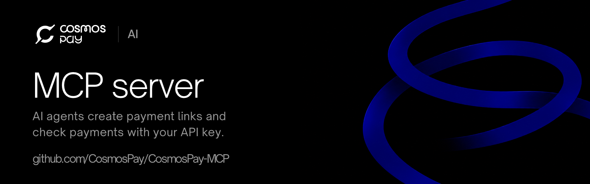

<p align="center">
  <a href="https://dev.cosmospay.lat/docs/ai/"></a>
</p>

# Cosmos Pay MCP server

An [MCP](https://modelcontextprotocol.io) server for the [Cosmos Pay](https://cosmospay.lat) Payments API. It lets an AI agent (Claude Code, Claude Desktop, Cursor, VS Code, Windsurf and any other MCP client) create stablecoin payment links and check payments on **Stellar, Solana and Monad** with your API key.

Cosmos Pay is non-custodial: a payment link is a request the customer pays from their own wallet, and the money settles on-chain straight to your address. **Nothing in this server signs or moves funds.**

Cosmos Pay (cosmospay.lat) is a different project from the Cosmos Network (ATOM).

## Tools

| Tool | What it does | Kind |
|---|---|---|
| `create_payment_link` | Create a payment request: a link (SEP-7 on Stellar, Solana Pay on Solana, EIP-681 on Monad), its QR code and a hosted checkout page | creates, moves no money |
| `get_payment` | One payment: status, amount, asset, chain, link, checkout URL and, once paid, the transaction hash | read |
| `get_payment_history` | A payment's status changes | read |
| `list_payments` | Payments, newest first, filtered by status, chain or date, paged | read |
| `validate_payment` | Check a transaction hash against a payment and settle it if it pays it | idempotent |
| `delete_payment` | Delete an unpaid payment so its link can no longer be paid | destructive |
| `get_summary` | Totals, settled volume, webhook health and a 30-day series | read |
| `get_balances` | Settled and pending amounts per asset | read |
| `list_stellar_assets` | Stellar asset codes and issuers to charge in (USDC, EURC...) | read |

Each tool carries MCP annotations (`readOnlyHint`, `destructiveHint`), so your client can ask before anything that writes.

## Setup

1. Create a secret API key in the [Cosmos Pay dashboard](https://dev.cosmospay.lat) (API keys). **Start with a `dv_` key**: it works on test networks with no real money. A `prod_` key works on mainnet.
2. Add the server to your MCP client with the key in its environment.

**Claude Code**

```bash
claude mcp add cosmos-pay --env COSMOS_PAY_API_KEY=dv_your_key -- npx -y @cosmosapp/pay_mcp
```

**Claude Desktop, Cursor, Windsurf** (`claude_desktop_config.json`, `.cursor/mcp.json`, `~/.codeium/windsurf/mcp_config.json`)

```json
{
  "mcpServers": {
    "cosmos-pay": {
      "command": "npx",
      "args": ["-y", "@cosmosapp/pay_mcp"],
      "env": { "COSMOS_PAY_API_KEY": "dv_your_key" }
    }
  }
}
```

**VS Code** (`.vscode/mcp.json`)

```json
{
  "inputs": [{ "type": "promptString", "id": "cosmos-pay-key", "description": "Cosmos Pay API key", "password": true }],
  "servers": {
    "cosmos-pay": {
      "type": "stdio",
      "command": "npx",
      "args": ["-y", "@cosmosapp/pay_mcp"],
      "env": { "COSMOS_PAY_API_KEY": "${input:cosmos-pay-key}" }
    }
  }
}
```

Then ask your agent things like *"Create a payment link for 25 USDC on Stellar to my store's address"* or *"Which payments from this week are still pending?"*

## Configuration

| Variable | |
|---|---|
| `COSMOS_PAY_API_KEY` | Required. A secret key from the dashboard: `dv_` test networks, `prod_` mainnet. |
| `COSMOS_PAY_READ_ONLY` | `1` offers only the tools that read (no create, validate or delete). |
| `COSMOS_PAY_API_URL` | Another Payments API root (default `https://api.cosmospay.lat/cosmos-api`). |
| `COSMOS_PAY_CHECKOUT_URL` | Another hosted checkout origin (default `https://payments.cosmospay.lat`). |

## Security

- The API key is read from the environment only. It is never a tool argument, never logged and never part of a result.
- The key decides the network: every payment the tools return names it (`testnet` or `public`), and the server tells the agent which one it is on.
- A key's scopes limit what the server can do: create a key with only the permissions you want the agent to have, or run it read-only.
- Payments settle to the address in the request. Check the `destination` an agent proposes before you share a link.

## Links

- Docs: https://dev.cosmospay.lat/docs/ (index for LLMs: https://dev.cosmospay.lat/docs/llms.txt)
- Payments API reference: https://dev.cosmospay.lat/docs/api/
- JavaScript/TypeScript SDK: [`@cosmosapp/pay_sdk`](https://www.npmjs.com/package/@cosmosapp/pay_sdk)
- Agent skill for coding agents: [CosmosPay-Skill](https://github.com/CosmosPay/CosmosPay-Skill)

## Development

```bash
npm ci
npm run typecheck && npm test && npm run build
COSMOS_PAY_API_KEY=dv_your_key npm run inspect   # MCP Inspector against the built server
```

Apache-2.0.
